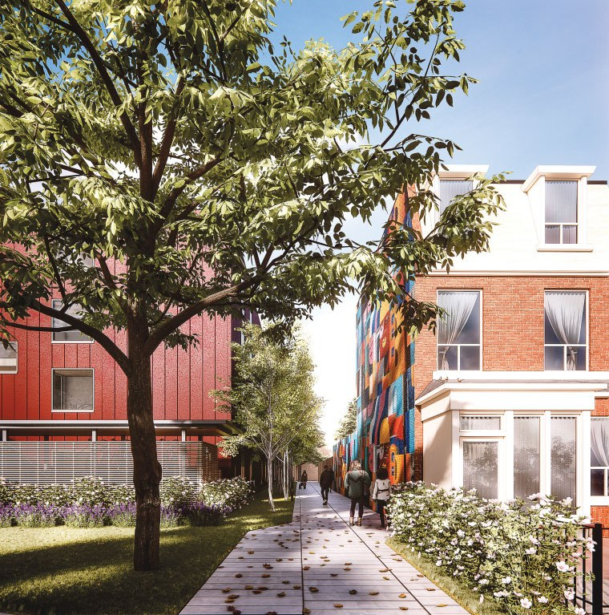

## Week #9 agenda

:::: {.columns}
::: {.column width="40%"}
- Why make an *economic* case?
- Climate and clean air
- Household transportation costs
- Reinvigorating downtowns and main streets
- Compact development and fiscal health
- Safety and injury
- Equity and resilience
- Discussion and final project Q&A
:::

::: {.column width="60%"}
{.bordered-img fig-align="center" width="500px"}
:::
::::

::: notes
Welcome back. For eight weeks we've made the case for sustainable transportation mostly in environmental, health and equity terms. Tonight we put on a different hat — the economist's, or really the city budget director's — and ask a blunt question: does sustainable urban transportation *pay*? Who saves money, who earns money, and who avoids costs when people can walk, bike, take transit or share a car instead of owning and driving one for every trip?

This matters for your final projects and for your careers. Most transportation decisions are ultimately budget decisions — a city council choosing between a road widening and a bus lane, a household choosing between a second car and a transit pass, a small town choosing between a new subdivision on the edge and rebuilding its Main Street. If you can only make the moral case, you'll win some of those arguments. If you can also make the economic case, you'll win a lot more of them.

We'll move through six benefit areas — climate and clean air, household costs, downtown vitality, compact development, safety, and equity — drawing on this week's readings: recent issues of APA's *Planning* magazine and two research articles, one on the monetized co-benefits of cutting transportation emissions and one on carsharing.

The photo on the right is Davis Avenue in Mobile, Alabama — "The Avenue" — in the mid-20th century, from a *Planning* article on reviving historic Black Main Streets. Look closely: people on foot, a rack full of bicycles, a streetcar track and a "No Parking" sign. For the first half of the century this street was the economic heart of Mobile's African American community, with businesses where, as one resident put it, you could buy everything "from birth to burial." It declined after urban renewal and highway building in the 1950s and 60s. Keep it in mind as a reminder that walkable, transit-served main streets were once the norm, and that their decline was the product of policy choices that can be reversed.
:::

---

## Climate and Clean Air: Costs Grow with Car Travel

:::: {.columns}
::: {.column width="50%"}
{.bordered-img fig-align="center" height="330"}
:::

::: {.column width="50%"}
- Urban passenger transportation emissions grow with income and urbanization: CO₂ rose from **5.18 to 19.66 million tons** (2011–2022), pollutants from **25,400 to 66,800 tons** [(Weng et al., 2025)]{.cite}
- CO₂ and local pollutants (CO, NOx, HC, PM) come from the **same tailpipes**, so policies that cut one usually cut the other — a *co-benefit*
- Pollution has real costs: cardiovascular and respiratory disease, lost work and school days
- Los Angeles shows sustained clean-air progress is possible: public demand, policy entrepreneurship, coordination and technology [(Carlson, 2026)]{.cite}
- Cleaner vehicles still matter, but federal support is shifting: **97%** of \$2 billion in 2025 Low- or No-Emission bus grants went to *low*- rather than *zero*-emission buses; locally, Rolling Meadows, IL requires EV-ready parking in new apartments [(Vock, 2026)]{.cite}
:::
::::

::: notes
Let's start with climate and air quality, because it's where economists have done the most work putting a price on transportation's side effects.

The chart on the left comes from Weng and colleagues, published in *Urban Climate* in 2025. They modeled urban passenger transportation in Fujian Province, a fast-growing coastal province in China. Look at the shape: CO₂ emissions from urban passenger travel nearly quadrupled in a little over a decade, from about 5 million to almost 20 million tons, and local air pollutants — carbon monoxide, nitrogen oxides, hydrocarbons and particulates — rose right alongside. That's what happens when rising incomes and urbanization translate into more and longer car trips. U.S. metros went through the same curve decades earlier.

The key concept here is *co-benefits*. Carbon dioxide and the pollutants that make people sick come out of the same tailpipes. So when a policy reduces driving, you don't just get a climate benefit that shows up decades from now and spread across the globe — you also get cleaner air right now, in the neighborhoods next to busy roads, which shows up in fewer asthma attacks, fewer hospital visits and fewer lost work days. Those are costs that households, employers and health systems pay.

And if this feels intractable, the summer issue of *Planning* reviewed Ann Carlson's new book *Smog and Sunshine*, about how Los Angeles cleaned up its air. The reviewer's takeaway is that it took a sustained combination of public demand, policy entrepreneurs, government coordination and engineering breakthroughs — and that several of those lessons can be applied to greenhouse gases. In other words, transportation emissions have been bent downward before.

One more current-events note from the spring 2026 *Planning*. Daniel Vock's article "Charge Anxiety" documents how federal electric vehicle policy has reversed — tax credits ended, charging grants paused — and how much of the transition now depends on local governments and the private sector. Two details stand out. First, when U.S. DOT awarded \$2 billion through the Low- or No-Emission bus program in November 2025, about 97 percent went to low-emission buses like diesel hybrids and natural gas, not zero-emission electric buses. Second, closer to home, Rolling Meadows in the northwest suburbs installed free public chargers at city hall and now requires new apartment and condo buildings to be "EV ready." EVs are part of the clean-air story, but as the next slide shows, they're not the whole story.
:::

---

## Mode Shift Delivers the Largest Economic Return

:::: {.columns}
::: {.column width="55%"}
{.bordered-img fig-align="center" width="100%"}
:::

::: {.column width="45%"}
- **Study area**: urban passenger transportation in **Fujian Province**, a coastal province in southeastern China, modeled to 2035 [(Weng et al., 2025)]{.cite}
- **RMB** (renminbi) is China's currency, counted in yuan; about 7.2 RMB = US\$1 in 2025. Avoided CO₂ is valued at China's 2023 carbon market price and pollutants at its environmental protection tax
- **Transportation structure optimization** (less private car travel, more transit and bus service, capped car growth) had the largest single benefit: **9.11 billion RMB** (≈ US\$1.3 billion) and a **23.9%** cut in CO₂
- Electric vehicles cut more *local pollutants* (29.7%), but shifting trips cut more *carbon*
- Combining policies: **18.44 billion RMB** (≈ US\$2.6 billion), **44%** less CO₂, **49%** fewer pollutants
:::
::::

::: notes
Here's where Weng and colleagues get explicitly economic. First, the geography: these figures are for one province, not a city or the whole of China. Fujian is a coastal province in southeastern China, across the strait from Taiwan, and the model covers urban passenger transportation there — cars, taxis, buses and so on — projected out to 2035 and compared with a business-as-usual baseline. The money is in RMB, renminbi, China's currency, whose unit is the yuan; at roughly 7.2 RMB to the U.S. dollar, 9.1 billion RMB is about 1.3 billion dollars. The authors valued avoided CO₂ at the average price on China's national carbon market in 2023, and avoided pollutants at the rates of China's environmental protection tax. So these are conservative, market- and tax-based values, not full estimates of health damages.

The four single-policy scenarios on the chart are: more green space along roads, technological progress in vehicle efficiency, promoting new energy vehicles — mostly EVs — and what they call transportation structure optimization. That last one is the one to focus on: reducing private car travel by about one percent a year, increasing public transit service, growing the bus fleet, and capping how fast the private car fleet can grow. In plain terms: mode shift.

Look at the bars. Mode shift — TSO — produced the largest economic benefit of any single policy, about 9.1 billion RMB, and the largest cut in CO₂, almost 24 percent below the baseline by 2035. Electric vehicles did better on local pollutants, which makes sense — they eliminate the tailpipe — but changing *how* people travel did more for the climate than changing *what* they drive. And notice in the donut chart that most of the monetized benefit, about 83 percent across the single scenarios, came from avoided carbon.

The second lesson is that policies compound. When the authors combined mode shift with EVs, technology and green space, benefits roughly doubled — 18.4 billion RMB, or about 2.6 billion dollars, with CO₂ down 44 percent and pollutants down almost half. There's no single silver bullet, but a package that leads with mode shift and adds cleaner vehicles is the economically strongest option. That's a useful framing for any of you whose final project compares policy alternatives.
:::

---

## Household Expenditures: Transportation Is the Second-Largest Cost

:::: {.columns}
::: {.column width="50%"}
- Transportation is typically a household's **second-largest expense after housing**, about **17%** of spending, most of it buying, insuring, fueling and maintaining vehicles [(BLS, 2024)]{.cite}
- Housing *plus* transportation costs above **45% of income** signal unaffordability; car-dependent locations can erase "cheap" housing savings [(CNT, 2026)]{.cite}
- Shared and transit options let households **own fewer cars**: carsharing sited at transit interchanges cut private car mode share from **28.0% to 22.8%** and raised carsharing + transit trips [(Zhong et al., 2025)]{.cite}
- Parking mandates add to housing costs: Sacramento found it was forcing projects to build "incredibly expensive" garages, then **eliminated parking requirements** citywide [(Stromberg, 2025)]{.cite}; Donald Shoup called minimum parking requirements "a fertility drug for cars" [(DeAngelis, 2025)]{.cite}
:::

::: {.column width="50%"}
{.bordered-img fig-align="center" height="290"}
:::
::::

::: notes
Now let's move from the planet's budget to the household budget. For most American households, transportation is the second-largest expense after housing — about 17 percent of spending according to the Bureau of Labor Statistics' Consumer Expenditure Survey — and the large majority of that is the cost of owning cars: purchase or loan payments, insurance, gas, maintenance and repairs. Unlike a house, a car loses value every year.

The Center for Neighborhood Technology's Housing + Transportation Affordability Index makes the connection to location. It argues that housing plus transportation should be under about 45 percent of household income, and shows that a "cheap" house at the edge of a region can be expensive once you add the two or three cars needed to live there. That's an economic argument for compact, transit-served neighborhoods that's grounded in household budgets, not abstractions.

So how do households shed a car? Zhong and colleagues, writing in *PLOS ONE*, modeled where and how to operate a carsharing system to maximize both the operator's revenue and broader social benefits. Their best-performing scheme put carsharing sites at transit interchanges and priced them reasonably. In that scenario, the private car mode share dropped from 28 to about 23 percent, and combined carsharing-plus-transit trips grew. Carsharing doesn't replace transit — notice in the chart that some single-mode bus and subway trips shift too — but positioned well, it fills the gaps that otherwise push households into owning another car. Finally, parking. Every parking space a zoning code requires gets built into the cost of housing and retail, whether or not the household owns a car. In a *Planning* podcast interview, Sacramento's community development director Tom Pace describes how the city's parking requirements forced infill projects to either seek waivers or build "incredibly expensive" garages and lots. Sacramento cut requirements back, then eliminated them entirely, and removed maximum density limits for transit-oriented infill. The same issue's archive feature recalls Donald Shoup's famous line from 1997 that minimum parking requirements are "a fertility drug for cars." When households aren't forced to pay for parking they don't need, car-light living becomes more affordable.
:::

---

## Reinvigorating Downtowns and Main Streets

:::: {.columns}
::: {.column width="55%"}
{.bordered-img fig-align="center" height="330"}
:::

::: {.column width="45%"}
- Many towns carry the costs of infrastructure "designed for a different era" while operating far below capacity [(Winton, 2026)]{.cite}
- **Bastrop, Texas**: narrower lanes, safer pedestrian crossings and a connected grid increased transportation options while reducing long-term infrastructure redundancy and maintenance
- "Walkability supports local commerce, improves public health, strengthens social connections, and increases safety and independence"
- **Mobile, Alabama**: \$3.5 million (ARPA) plan for historic Davis Avenue projects visitor demand for **52,000 sq. ft.** of new commercial space and **\$7.9 million** in spending, with grants and zero-interest loans to avoid displacement [(Walker, 2025)]{.cite}
:::
::::

::: notes
Let's talk about downtowns. One of the most consistent findings in the economics of sustainable transportation is that people on foot, on bikes and on transit are good for local business — they visit more often, linger longer and spend locally — and that streets designed for moving cars quickly through a place tend to hollow it out.

Gregory Winton's piece in the summer *Planning* is about small towns, but the logic scales up to neighborhood business districts in Chicago. He describes towns whose Main Streets are lined with vacant storefronts while they still carry the cost of infrastructure built for a different era. His prescription has four parts, and the one most relevant to us is "reclaim the walkable grid." Most historic towns were built at a human scale for people, not cars, and walkability, he writes, supports local commerce, improves public health, strengthens social connections and increases safety and independence.

Bastrop is his example. Its downtown improvements included narrower lane widths, safer pedestrian crossings and subdivision standards that reinforce a connected grid. Notice the economic claim: those changes increased transportation options *and* reduced long-term infrastructure redundancy and maintenance. Narrower streets are cheaper to maintain. He also points to adaptive reuse, like a former department store in Washington, Iowa, carved into six small shops — the kind of space small, local businesses can actually afford.

Now go back to the Davis Avenue photo from the agenda slide. Philip Walker's article in the spring 2025 *Planning* describes Mobile County's plan to revive that street. Using 3.5 million dollars in federal American Rescue Plan funds, the county commissioned a Civil Rights and Cultural Heritage District plan, with an interpretive center, a park and a business development strategy. The plan's market analysis projects visitor demand for about 52,000 square feet of new commercial space and 7.9 million dollars in spending to support local businesses. Importantly, it pairs that investment with strategies to avoid displacement, like grants and zero-interest loans to rehabilitate existing homes. One stakeholder worried that "bike lanes lead to gentrification" — a concern we'll come back to under equity. Think about Chicago's commercial corridors — Milwaukee Avenue, 53rd Street in Hyde Park, Bronzeville's 47th Street — through this same lens.
:::

---

## Compact Development and Fiscal Health

:::: {.columns}
::: {.column width="40%"}
{.bordered-img fig-align="center" width="100%"}
:::

::: {.column width="60%"}
- Low-density growth can look like a fiscal win, but "initial tax gains may be offset over time by the cost of maintaining" it [(Winton, 2026)]{.cite}
- **Montana**: population grew **10%** (2010–2020) while housing units grew **7%**. The 2023 "Montana Miracle" laws allowed ADUs by right and multifamily and mixed-use buildings in commercial zones [(Moore, 2026)]{.cite}
- "Restricting density in the cities forces development to sprawl outwards, and that takes over a lot of the surrounding rural areas." — Kendall Cotton
- **Sacramento** made transit-oriented infill its top priority, with no parking requirements or maximum density limits [(Stromberg, 2025)]{.cite}
- **Toronto**: a parking lot becomes ~**78** homes with rents capped at **30%** of income [(Koy, 2025)]{.cite}
:::
::::

::: notes
Compact development is where transportation economics and land use economics meet. Sprawl isn't only a transportation problem; it's a long-term municipal liability. Every new mile of road, sewer and water main at the edge has to be maintained and eventually replaced, and low-density development often doesn't generate enough tax revenue per acre to pay for it. Winton puts it plainly: initial tax gains from edge growth may be offset over time by the cost of maintaining it.

The Montana story in the same issue shows the housing side. Between 2010 and 2020, Montana's population grew about 10 percent but its housing stock only about 7 percent, and home prices jumped 36 percent in three years. In 2023 a bipartisan coalition passed what the press dubbed the "Montana Miracle": an accessory dwelling unit allowed by right on single-family lots, and multifamily and mixed-use buildings legalized in commercial zones. After a lawsuit, the state supreme court upheld the laws this year.

Read the quote from Kendall Cotton, a task force member: restricting density in cities forces development to sprawl outward into rural areas. What's interesting economically and politically is the coalition — environmentalists, free-market property-rights advocates and conservatives protecting farmland all supported the same reforms for different reasons. For transportation, the payoff is that more homes near existing jobs, shops and transit mean shorter trips, more trips on foot or by transit, and fewer miles of new road to maintain. Planners quoted in the article caution that it's still too early to measure the impact on affordability — a good reminder to look for evidence, not just intentions.

Two more examples from the fall 2025 *Planning*. Sacramento decided to be, in its planning director's words, "pro-housing, pro-infill, pro-transit," and made transit-oriented infill its number-one priority — no parking requirements and no maximum density limits for those projects. And in Toronto, one of the least affordable cities in North America, the city is partnering with a community land trust to turn a municipal parking lot in Kensington Market into about 78 permanently affordable apartments, with rents capped at 30 percent of residents' incomes. That's the rendering on the left. Land used to store cars in a walkable, transit-rich neighborhood is some of the most valuable land a city owns.
:::

---

## Safety and Injury: The Hidden Costs of Car Dependence

:::: {.columns}
::: {.column width="50%"}
- U.S. traffic crashes cost **\$340 billion** in economic costs and **\$1.4 trillion** in total societal harm (2019) [(Blincoe et al., 2023)]{.cite}
- Nearly **41,000** people died on U.S. roads in 2023 [(NHTSA, 2025)]{.cite}
- Safer street design is also cheaper street design: Bastrop's narrower lanes and safer crossings [(Winton, 2026)]{.cite}
- The "diminishing play radius": in 1919 a child walked alone **8 miles** to go fishing; a century later, his great-grandson could go no farther than the end of the street [(Glenn, 2026)]{.cite}
- **Bike buses** — scheduled group rides to school — now number **470+** in at least **17 countries**, including Montclair, NJ, with routes to 10 schools [(Chudwin, 2025)]{.cite}
:::

::: {.column width="50%"}
{.bordered-img fig-align="center" width="100%"}
:::
::::

::: notes
Safety is usually framed as a moral issue, and it is one. But it's also one of the largest economic costs of our transportation system, and it's paid by everyone. NHTSA's most recent comprehensive estimate put the economic cost of U.S. motor vehicle crashes in 2019 at about 340 billion dollars — medical care, emergency services, lost productivity, property damage, insurance administration, congestion — and the total societal harm, once you include lost quality of life, at about 1.4 trillion. In 2023 alone, nearly 41,000 people died on U.S. roads, and as we saw in Week 2, pedestrian deaths have risen especially fast.

The good news is that safer streets are often cheaper streets. Narrower lanes, shorter crossings and lower design speeds — like Bastrop's — reduce crash severity and cost less to build and maintain than wide, fast arterials.

There's also a cost we rarely count: freedom. Ezra Haber Glenn's essay in the fall *Planning* revisits the 1956 film *The Red Balloon*, in which a young boy roams Paris on his own. He cites research on the "diminishing play radius": in 1919 a child walked alone eight miles to go fishing; less than a century later, his great-grandson couldn't go past the end of the street. A focus on cars and parking is one of the explanations. When children can't walk or bike safely, parents become chauffeurs — that's household time and money — and kids lose independence and physical activity, which carries its own long-term health costs.

There's a grassroots response worth knowing about: the bike bus. Popularized in Barcelona, a bike bus is a scheduled group ride to school along a set route, usually once a week, with adults leading and sometimes blocking traffic. The fall 2025 *Planning* reports more than 470 bike buses in at least 17 countries. Montclair, New Jersey's is one of the largest in the U.S., with routes to ten schools, and in York County, Pennsylvania, county planners — not just parents — are now organizing one. Organizers say it has also built support for permanent safety improvements, which is exactly how a cheap, temporary intervention can change long-term investment.
:::

---

## Equity and Resilience: Who Benefits?

:::: {.columns}
::: {.column width="50%"}
{.bordered-img fig-align="center" width="100%"}
:::

::: {.column width="50%"}
- Highways and other transportation infrastructure have long divided communities of color, costing generational wealth, health and environmental quality [(Archer, 2025)]{.cite}
- **Chicago**: 5200 N. and 5200 S. Ashland Ave. are "folded map twins" 12 miles apart; homes in majority-Black U.S. neighborhoods are undervalued by ~**\$48,000** each, **\$156 billion** in all [(Saunders, 2026)]{.cite}
- Phoenix's Shade Plan adds shade at **bus stops** and "cool corridors," prioritizing **low- and mid-low-income neighborhoods** [(Trego et al., 2026)]{.cite}
- Access by walking, biking and transit "isn't just about mobility; it's an equity and participation issue" [(Marquis, 2026)]{.cite}
:::
::::

::: notes
The last benefit area is equity, and it ties the others together. Households with lower incomes, older adults, people with disabilities and teenagers are the most likely to rely on walking, biking and transit, and they're often the most exposed to traffic danger, pollution and heat. So the question is not only whether sustainable transportation produces economic benefits, but *who receives them* — and who has borne the costs of past transportation decisions.

On that history, the winter 2026 *Planning* reviewed Deborah Archer's book *Dividing Lines*, which documents how highways, urban renewal, rail lines and even pedestrian infrastructure were used as barriers that segregated communities of color — costing generational wealth when homes were taken, and leaving health and environmental burdens on those who stayed. Davis Avenue in Mobile is one example; Chicago's Dan Ryan Expressway is another.

The same issue has a Chicago story you'll recognize. Pete Saunders writes about Tonika Lewis Johnson's "Folded Map" project and her book *Don't Go* with Maria Krysan. Fold a map of Chicago at Madison Street and 5200 North Ashland lines up with 5200 South Ashland — two addresses 12 miles apart on the same street, with very different demographics. Brookings researcher Andre Perry found that homes in majority-Black neighborhoods across U.S. metros are undervalued by about 48,000 dollars each, about 156 billion dollars in all, even after accounting for home and neighborhood quality. That's an economic cost of segregation, and transportation investments can either reinforce it or help reverse it. And remember the Mobile stakeholder who said "bike lanes lead to gentrification": investments must come with displacement protections so that current residents share the benefits.

The fall *Planning* article by Trego, Hondula, Keith and Meerow on Phoenix's Shade Plan is a great example of thinking about this, and it's also a climate adaptation story. Research shows shade reduces the temperature people feel more than any other single environmental change. Phoenix adds shade structures at bus stops and along heavily used walking "cool corridors," treats shade as critical infrastructure — like water or power, with budgets for maintenance — and explicitly prioritizes low- and mid-low-income neighborhoods. The transit shelter on the left isn't a luxury: if you're waiting for a bus at 110 degrees, shade determines whether transit is a viable option at all.

Bridget Marquis makes a parallel point about teens: public spaces must be reachable by walking, biking, micromobility and transit, or the teens who most need them can't use them — "it's an equity and participation issue." Remember Group 5's final project dataset: transit access in underserved Chicago neighborhoods. This is exactly the lens to apply — and Group 2's Ashland Avenue BRT corridor runs right through Johnson's folded map.
:::

---

## Discussion: Making the Economic Case

- Which **costs** of car dependence are paid by households, by governments, and by society at large? Which are easiest to put a dollar value on?
- Weng et al. found that **shifting trips** delivered more value than cleaner vehicles alone. Does that hold for Chicago? What would it take?
- Pick a Chicago corridor (e.g., Ashland Avenue, Milwaukee Avenue, 63rd Street): what would *reclaiming the walkable grid* cost, and who would benefit?
- For your **final project**: which economic benefit(s) could strengthen your argument, and what data could measure them?

::: notes
Let's put this to work. In small groups, take about ten minutes on these questions.

First, sort the costs of car dependence by who pays: households (vehicle ownership, fuel, time), governments (road maintenance, emergency services, parking) and society (pollution, climate, crashes). Which of these are easy to price and which are hard? That matters, because what gets priced tends to get counted in decisions.

Second, think about Weng and colleagues' finding that shifting trips out of cars beat cleaner cars alone. Would that hold in Chicago, where we already have a large transit network? What would it take — service, land use, pricing?

Third, pick a Chicago corridor — Ashland, which Group 2 is studying for bus rapid transit, Milwaukee Avenue, or 63rd Street — and apply Winton's small-town logic: what would reclaiming the walkable grid there cost, and who would benefit?

Finally, turn to your final projects. Almost every project in this class has an economic dimension: e-bike safety and crash costs, BRT and travel time savings, motorcycle fatalities, transit access in underserved neighborhoods, travel time to O'Hare. Identify one economic benefit that could strengthen your argument, and the data you'd use to measure it. [Have two or three groups report back, then open the floor for final project questions.]
:::

---

## References

::: {.references}
- Archer, D. N. (2025). *Dividing lines: How transportation infrastructure reinforces racial inequality*. W. W. Norton. Reviewed by J. Barajas in *Planning*, 92(1), 19.
- Blincoe, L., Miller, T., Wang, J.-S., Swedler, D., Coughlin, T., Lawrence, B., Guo, F., Klauer, S., & Dingus, T. (2023). *The economic and societal impact of motor vehicle crashes, 2019 (revised)* (DOT HS 813 403). National Highway Traffic Safety Administration.
- Carlson, A. (2026). *Smog and sunshine: The surprising story of how Los Angeles cleaned up its air*. University of California Press. Reviewed by D. Press in *Planning*, Summer 2026, p. 21.
- Center for Neighborhood Technology. (2026). *H+T Affordability Index*. https://htaindex.cnt.org
- Chudwin, E. (2025). It's bike-to-school time for sustainable transportation. *Planning*, 91(4), 9–10.
- DeAngelis, J. (2025). The future is electric and youth focused [Interview with B. M. Jose; includes "From the archive: Don't even think of parking here," June 1997]. *Planning*, 91(2), 28–29.
- Glenn, E. H. (2026). Can cities still give children the freedom to explore? *Planning*, 92(4), 11.
- Koy, M. (2025). The perfect (parking) spot for affordable housing. *Planning*, 91(4), 19.
- Marquis, B. (2026). Beyond the ban: Designing the third spaces teens need. *Planning*, 92(4), 15–17.
- Moore, T. (2026). Did the Montana Miracle answer the state's housing prayers? *Planning*, 92(3), 28–32.
- National Highway Traffic Safety Administration. (2025). *Traffic safety facts: 2023 data*. U.S. Department of Transportation.
- Saunders, P. (2026). 'Don't go' neighborhoods can create opportunities. *Planning*, 92(1), 7–9.
- Stromberg, M. (2025). Sacramento sets the pace for zoning reform [Interview with T. Pace]. *Planning*, 91(4), 13–14.
- Trego, S., Hondula, D., Keith, L., & Meerow, S. (2026). Plan for shade as critical infrastructure. *Planning*, 92(4), 13–15.
- U.S. Bureau of Labor Statistics. (2024). *Consumer expenditures in 2023* (Report 1112). U.S. Department of Labor.
- Vock, D. C. (2026). Charge anxiety. *Planning*, 92(2), 22–28.
- Walker, P. (2025). A celebrated Main Street is reimagined and reinvigorated. *Planning*, 91(2), 32–37.
- Weng, D., Zhang, H., Wen, X., Hu, X., & Zhang, L. (2025). Co-benefits of carbon and pollutant emission reduction in urban transport: Sustainable pathways and economic efficiency. *Urban Climate*, 60, 102348. https://doi.org/10.1016/j.uclim.2025.102348
- Winton, G. S. (2026). The big advantages of small town USA. *Planning*, 92(3), 16–18.
- Zhong, Y., Luo, Q., Gao, T., Long, Y., & Liu, L. (2025). Carsharing operation optimization with the comprehensive consideration of economic and social benefits. *PLOS ONE*, 20(2), e0315323. https://doi.org/10.1371/journal.pone.0315323
:::

::: notes
Here are the sources cited tonight. The four readings — the two issues of *Planning* and the Weng and Zhong articles — are in the week's literature folder. I've also cited a few standard national sources for household spending, housing-plus-transportation affordability and crash costs: the Bureau of Labor Statistics Consumer Expenditure Survey, the Center for Neighborhood Technology's H+T Index and NHTSA's crash cost and fatality reports. These are good starting points if your final project needs national benchmarks. See you next week.
:::
